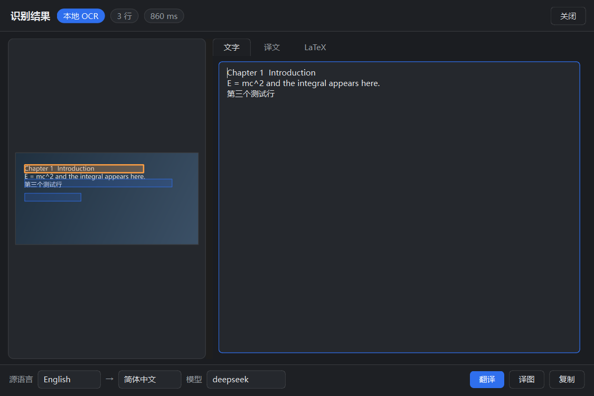

# TackShot · 图钉截图

Windows 上的截图 / 标注 / 贴图工具，C++17 + Qt 6 实现，截图标注全程本地，识别翻译走云端。
识别：百度图片翻译（文字+译文+坐标）、SimpleTex（公式 → LaTeX，懒加载）、视觉大模型兜底；Release 版内置云代理，**装完即用，无需注册任何服务**。



## 功能

| 模块 | 说明 |
| --- | --- |
| 截图 | 全局热键（默认 Ctrl+Alt+A）、框选实时跟手、多屏混合 DPI |
| 标注 | 矩形、椭圆、箭头、直线、画笔（贝塞尔平滑）、荧光笔、马赛克（笔刷）、文字、序号 |
| 标注编辑 | 点选标注 → 拖动移动、8 点手柄缩放、Delete 删除 |
| 长截图 | 滚动拼接，支持横向与纵向，自动找重叠 |
| 录制 | MP4（H.264 + AAC）与 GIF；系统声 / 麦克风 / 混音，WASAPI 原生格式采集 |
| 识别 | 百度图片翻译（文字/译文/坐标）+ SimpleTex（公式 LaTeX，切到 LaTeX 页才识别）+ 视觉大模型兜底 |
| 翻译 | 百度通用翻译（默认，多行合并一次请求）+ OpenAI 兼容接口备用（DeepSeek / Gemini / 自建），分块 + 缓存 + 术语表 + 降级 |
| 译图 | 独立调用：把译文渲染回原图（百度贴合或本地回填），钉到屏幕上 |
| 贴图 | 无边框钉图窗，滚轮缩放、双击 1:1、悬停标题条（复制/保存/关闭） |
| 外观 | 深色 / 浅色 / 跟随系统 |

## 下载安装

到 [Releases](https://github.com/AvR0raa/TackShot/releases) 下载 TackShotSetup.exe（约 54 MB）。

- 单文件安装器，装到 %LOCALAPPDATA%\Programs\TackShot，不需要管理员权限；
- 识别 / 翻译 / 译图 / 公式识别开箱即用（走内置云代理公共额度）；
- 首次运行会弹 SmartScreen（未签名），点「更多信息 → 仍要运行」；
- 卸载：安装目录下的 Uninstall.exe，或「应用和功能」里找 TackShot。

## 系统要求

- Windows 10 1809+ / Windows 11，x64
- 无需安装 VC++ 运行库或 Qt（安装包已内置）
- 多显示器、混合 DPI 已支持（每屏独立覆盖层）

## 从源码构建

依赖（自行准备，不入库）：Qt 6.8.x (MinGW 13.1)、MinGW-w64 13.1。

```powershell
powershell -ExecutionPolicy Bypass -File tools\build.ps1        # 编译主程序 -> build\TackShot.exe
powershell -ExecutionPolicy Bypass -File tools\build_setup.ps1  # 打包安装器 -> dist\TackShotSetup.exe
```

源码构建默认不含内置云代理（用户自配凭据直连）；如需内置自己的代理，
参见 [docs/DEPLOY_PROXY.md](docs/DEPLOY_PROXY.md) 部署云函数后把 URL 写入
`tools/proxy_local.json` 再构建（该文件不入库）。

## 隐私

- 截图、标注、长截图、录制全部本地完成，不联网；
- 「翻译」「识别」需要联网：**Release 版默认走作者的云代理**（图片/文字会上传到百度翻译、SimpleTex，代理只做签名转发、不存储内容，密钥不随安装包分发）；也可以在 设置 → 识别 填自己的百度/SimpleTex 凭据直连官方；
- 用户自配的 Key 用 Windows DPAPI 加密存放在 %LOCALAPPDATA%\TackShot\secrets.dat，不落明文；
- 翻译缓存只存译文，不存原图。

## 已知限制

- 识别需要联网；自配凭据时：百度需 APPID/密钥（需分别开通图片翻译与通用文本翻译），SimpleTex 需 UAT，视觉模型需支持图片输入；
- 百度通用文本翻译免费标准版限 1 次/秒（客户端已自动等待重试）；
- 混合 DPI 且两块屏缩放不同时，覆盖层只覆盖鼠标所在的那块屏；
- 未做代码签名，SmartScreen 会提示。

## 目录

```
src/        主程序
cloud/      云代理（Cloudflare Workers / 腾讯云函数，密钥只存云端）
setup/      Win32 安装器桩（自解压 + 快捷方式 + 卸载）
res/        图标、manifest、版本资源
tools/      构建脚本、mock 服务器、自检脚本
docs/       验证记录与云代理部署文档
```

## 致谢

百度翻译开放平台、SimpleTex、Qt。
